<!--
**Nguyencoder11/Nguyencoder11** is a ✨ _special_ ✨ repository because its `README.md` (this file) appears on your GitHub profile.
-->

  
  
  
  

######

# Hi  My name is Le Lenh Nguyen (Lee) 

### I'm a

<!--- 📫 How to reach me **_..._**-->
- 🖥️ See me at **_[My Portfolio](https://lenhnguyen403-portfolio-io.vercel.app/)_**
- 🔭 I’m currently working on **_CI/CD with Github Actions, GitLab CI_**
- 👯 I’m looking to collaborate on **_Facebook, LinkedIn_**
- 🧠 I’m currently learning: **_Spring Boot, DDD, Microservices, ReactJS, Angular22, NodeJS+ExpressJS, UI/UX Design_**
- 🌍 I'm based in Viet Nam
- ⚡ Fun fact **_"Backend is the invisible engine that powers seamless user experiences."_**
<!--- 🤝 I’m looking for help with **_..._**-->
<!--- 👨‍💻 All of my projects are available at **_..._**
- ❓ Ask me about **_..._**
- 📄 Know about my experiences **_..._**-->

<table>
  <tr align="center">
    <td>
      

        
      

    </td>
    <td>
      

        
      

    </td>
  <tr>
</table>

######

# 🌐 Contact Me

######

# 💻 Tech Stack - My Skill Set

<!--

-->

# 👯 Community

# 📊 Github Stats

<table>
  <tr align="center">
    <td valign="top">
      <h3>GitHub Performance Overview</h3>
      
    </td>
    <td valign="top">
      <h3>Top Language Stats</h3>
      
    </td>
  </tr>
  <tr align="center">
    <td valign="top" colspan="2">
      <h3>Contribution Stats</h3>
      
    </td>
  </tr>
</table>

###

  <picture>
    <source media="(prefers-color-scheme: dark)" srcset="https://raw.githubusercontent.com/lenhnguyen403/lenhnguyen403/output/pacman-contribution-graph-dark.svg">
    <source media="(prefers-color-scheme: light)" srcset="https://raw.githubusercontent.com/lenhnguyen403/lenhnguyen403/output/pacman-contribution-graph.svg">
    
  </picture>
   

---

<!-- 

 -->
